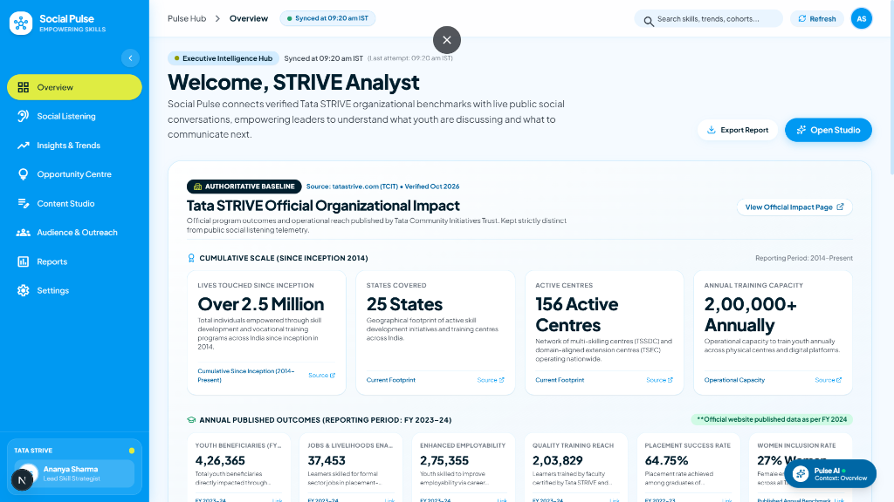

# Social Pulse Intelligence — Tata STRIVE

<div align="center">



### **Empowering Indian Youth with Real-Time Skilling & Social Intelligence**
*Transforming raw public chatter across India into prioritized, actionable skilling campaigns grounded in empirical evidence.*

[](https://nextjs.org/)
[](https://www.typescriptlang.org/)
[](https://tailwindcss.com/)
[](https://fastapi.tiangolo.com/)
[](https://www.python.org/)
[](https://pytorch.org/)
[](https://groq.com/)
[](https://sqlite.org/)

</div>

---

## 💡 The Core Message

> **Social Pulse doesn't just tell Tata STRIVE what people are talking about.**  
> It helps the leadership and mobilization teams understand **why it matters** and **what to communicate next**.

The signature differentiator is the **Conversation-to-Campaign Engine**: every insight shows authentic supporting posts, explains its strategic value to Tata STRIVE, ranks opportunities via a transparent 5-factor mathematical model, and automatically generates high-impact multi-channel campaigns (LinkedIn, Instagram, WhatsApp) with measurable calls-to-action.

---

## ⚡ 2-Minute Quickstart (Run the Website Locally)

Anyone can clone and run Social Pulse immediately. No complex database setup is required—the project uses an integrated, thread-safe SQLite database and local transformer pipelines.

### 1. Clone the Repository
```bash
git clone https://github.com/Tata-STRIVE/Hackathan-2.0-social_pulse-Team2.git
cd Hackathan-2.0-social_pulse-Team2
```

### 2. Start the Backend (FastAPI on Port 8000)
In your first terminal:
```bash
cd backend
python -m venv venv

# Windows
venv\Scripts\activate
# macOS / Linux
source venv/bin/activate

pip install -r requirements.txt
python -m uvicorn app.main:app --reload --port 8000
```
*Backend is now live at `http://localhost:8000` (Interactive Swagger docs: `http://localhost:8000/docs`).*

### 3. Start the Frontend (Next.js on Port 3000)
In your second terminal:
```bash
cd frontend
npm install
npm run dev
```
*Frontend is now live at **[http://localhost:3000](http://localhost:3000)**.*

---

## 🗺️ System Architecture

```mermaid
flowchart TB
    subgraph SOURCELAYER["1. Multi-Source Public Connectors"]
        YOUTUBE["YouTube Data API v3<br/>(Videos & Comments)"]
        GDELT["GDELT DOC 2.0 API<br/>(News & Policy Events)"]
        GNEWS["Google News RSS<br/>(Regional State Headlines)"]
        BSKY["Bluesky AT Protocol<br/>(Public Skilling Discourse)"]
        GPLACES["Google Places API<br/>(Physical STRIVE Centre Reviews)"]
        CSVIMPORT["Direct CSV Ingestion<br/>(Field Mobilization Surveys)"]
    end

    subgraph INGESTION["2. Ingestion & Preprocessing"]
        COLLECTOR["Collector & Caching Engine<br/>(collector.py / 30-min cache)"]
        DEDUP["URL Hash Deduplication<br/>(Strict Unique URL Index)"]
        TAXONOMY["Deterministic Taxonomy Engine<br/>(13 Skilling Domains)"]
    end

    subgraph STORAGE["3. Authoritative Storage (SQLite)"]
        DB_POSTS[("posts Table<br/>194+ Genuine Posts")]
        DB_METRICS[("daily_topic_metrics Table<br/>74+ Metric Observations")]
        DB_CAMPAIGNS[("campaigns Table<br/>Persisted Drafts")]
        DB_REPORTS[("reports Table<br/>Generated CSVs on Disk")]
    end

    subgraph ENGINES["4. Machine Learning & Analytical Engines"]
        ROBERTA["CardiffNLP RoBERTa<br/>(twitter-roberta-base-sentiment)"]
        ETS["Holt-Winters ETS Forecaster<br/>(statsmodels / >=21 Day Guardrail)"]
        OPP_SCORER["Opportunity Radar Scorer<br/>(5-Factor Mathematical Model)"]
        SKILLS_EXTRACT["Emerging Skills Extraction<br/>(Groq LLaMA-3.3 + Catalog Matcher)"]
        PULSE_AI["Pulse AI Assistant Engine<br/>(Contextual Multi-Turn RAG)"]
    end

    subgraph API_GATEWAY["5. API Gateway (:8000 & Next.js Rewrites)"]
        API_TOPICS["/api/topics & /api/topics/{id}/series"]
        API_OVERVIEW["/api/overview"]
        API_OPP["/api/opportunities"]
        API_AUDIENCE["/api/audience"]
        API_REPORTS["/api/reports & /download"]
        API_SENTIMENT["/api/sentiment/analyze & /batch"]
        API_ASSISTANT["/api/assistant/chat"]
        API_STUDIO["/api/ai/generate"]
    end

    subgraph FRONTEND["6. Next.js 16 Presentation Layer (:3000)"]
        PAGE_OVERVIEW["Overview (/)"]
        PAGE_FEED["Listening Feed (/feed)"]
        PAGE_TRENDS["Trends & Insights (/trends)"]
        PAGE_OPP["Opportunity Radar (/opportunities)"]
        PAGE_STUDIO["AI Campaign Studio (/studio)"]
        PAGE_AUDIENCE["Audience & Outreach (/audience)"]
        PAGE_REPORTS["Reports (/reports)"]
        DRAWER_PULSE["Pulse AI Chat Assistant"]
        DRAWER_ROBERTA["RoBERTa Sentiment Drawer"]
    end

    %% Pipeline Connections
    SOURCELAYER --> COLLECTOR
    COLLECTOR --> DEDUP
    DEDUP --> TAXONOMY
    TAXONOMY --> STORAGE

    STORAGE --> ENGINES
    ENGINES --> API_GATEWAY
    API_GATEWAY --> FRONTEND
```



---

## 📦 Product Modules & Key Features

### 1. Executive Overview (`/`)
- **Top 3 Impact Cards**: Computed dynamically from real stored posts:
  - *Most Discussed*: 7-day conversation volume leader.
  - *Fastest Growing*: Highest week-over-week velocity.
  - *Needs Attention*: Highest ratio of unanswered questions and negative friction.
- **Learner Voices**: Direct stream of authentic youth questions with quotes, authors, and source links.
- **Volume Telemetry Curve**: Interactive daily time-series of public conversation volume.

### 2. Social Listening Feed (`/feed`)
- **5 Live Data Connectors**: Ingests real-time discussions from YouTube (with inline playback), GDELT DOC 2.0 News, Google News RSS, Bluesky AT Protocol, and Google Places.
- **Direct CSV Ingestion**: Upload custom mobilization surveys or offline center reviews; includes 1-click loading of 20 verified student feedback records.
- **RoBERTa AI Sentiment Drawer**: Test and analyze any text using the local Hugging Face transformer pipeline with confidence probabilities.
- **YouTube Comment Analysis**: Highlights top community questions and allows 1-click search filtering.

### 3. Trend Intelligence & Forecasting (`/trends`)
- **13-Topic Skilling Taxonomy**: Covers EV diagnostics, Solar PV, Digital Workplace & AI, Drone pilot training, Industrial IoT, Tele-health, Green hydrogen, and core vocational trades.
- **Holt-Winters ETS Time-Series Forecaster**: Rigorous 30/60/90-day trajectory modeling with strict **$\ge 21$ real days guardrail** (displays *"Building history"* if observations are sparse, strictly avoiding fabricated curves).
- **Emerging Trends & Skills**: Dynamic vocational skill clusters (Generative AI Prompting, EV BMS Testing, Rooftop Solar Grid-Tie, ATS Resume Engineering) linked directly to accredited Tata STRIVE programs with real evidence quotes.

### 4. Opportunity Radar (`/opportunities`)
- **Interactive Opportunity Map (Bubble Chart)**:
  - **X-Axis**: Demand (Real mention count in active window).
  - **Y-Axis**: Momentum (Growth % vs. previous equal-length period).
  - **Bubble Size**: Normalized audience engagement (likes + comments).
  - **Quadrants**: Calculated using statistical medians into *"Act Now"*, *"Prepare Content"*, *"Protect & Maintain"*, and *"Watch"*.
- **Why This Score (Stacked Bar Breakdown)**: Transparent visual breakdown of Volume (25%), Growth (25%), Relevance (25%), Engagement (15%), and Unmet Need (10%).
- **Momentum Over Time**: 30-day multi-line historical trajectory comparing top opportunities.

### 5. AI Campaign Studio (`/studio`)
- **Search Any Topic**: Suggests opportunities, taxonomy topics, and Tata STRIVE catalog courses, or allows custom user topics.
- **Grounded Multi-Channel Generation**: Produces targeted campaign copy for LinkedIn, Instagram, and WhatsApp.
- **Anti-Hallucination Guardrail**: Server-side validation inspects generated text; any invented metric not found in the database payload is rejected.
- **Persistent Saved Drafts**: Saves campaign drafts to SQLite with 1-click clipboard export and status tracking.

### 6. Audience Outreach & Centres (`/audience`)
- **Authentic Tata STRIVE Offline Centres**: Complete profiles, courses offered, contact details, and locations for physical training centres (Mumbai, Pune, Nashik, Hyderabad, Bengaluru, Delhi NCR, Mohali, etc.).
- **Categorized FAQs & AI Suggested Replies**: Real inquiries submitted by learners paired with official Tata STRIVE response copy.
- **Best Time to Post**: Hourly engagement distribution calculated from authentic published timestamps converted to **Indian Standard Time (IST, UTC+5:30)**.

### 7. Intelligence Reports (`/reports`)
- **On-Demand Report Generation**: Generates genuine CSV reports on disk with live metrics.
- **Direct File Streaming**: Downloads directly from `/api/reports/{id}/download`.

### 8. Pulse AI Assistant
- Floating conversational intelligence guide available on every page.
- Injects active screen context (`PageContext`) into Groq LLaMA-3 to answer specific questions about current metrics, opportunities, and Tata STRIVE courses.

---

## 🧠 AI Models & Decision Calculations Summary

### 1. CardiffNLP RoBERTa Sentiment Model
- **Model**: `cardiffnlp/twitter-roberta-base-sentiment-latest` (125M parameters).
- **Execution**: Runs locally inside FastAPI on PyTorch with zero external API dependency.
- **Labels**: `positive`, `neutral`, `negative` with 3-decimal confidence scores.

### 2. The 5-Factor Opportunity Priority Formula
$$\text{Priority Score} = \text{round}\Big(0.25 \times V + 0.25 \times G + 0.25 \times R + 0.15 \times E + 0.10 \times U\Big)$$
- **Volume ($V$, 25%)**: Normalized relative to peak topic in date range ($25 \le V \le 100$).
- **Growth ($G$, 25%)**: Velocity % vs previous period ($G = 70$ for new surges, up to 100 for high growth).
- **Relevance ($R$, 25%)**: Match against official Tata STRIVE curriculum ($95$ for flagship courses).
- **Engagement ($E$, 15%)**: Sum of likes, comments, and views normalized ($20 \le E \le 100$).
- **Unmet Need ($U$, 10%)**: Ratio of learner questions and negative friction ($20 \le U \le 100$).

*For in-depth mathematical formulations and parameter tables, see [docs/models-and-decisions.md](docs/README_AI_MODELS_AND_DECISIONS.md).*

---

## ⚙️ Environment Variables Reference

Create `.env` inside `backend/` and `.env.local` inside `frontend/` using the provided `.env.example` templates:

### Backend (`backend/.env`)
| Variable | Required? | Default | Description |
| :--- | :--- | :--- | :--- |
| `GROQ_API_KEY` | Optional | `""` | Powers Groq LLaMA-3.3-70B campaign synthesis and Pulse AI chat. |
| `YOUTUBE_API_KEY`| Optional | `""` | Enables live YouTube Data API v3 collection queries. |
| `PORT` | Optional | `8000` | Port for the FastAPI server. |

### Frontend (`frontend/.env.local`)
| Variable | Required? | Default | Description |
| :--- | :--- | :--- | :--- |
| `NEXT_PUBLIC_API_URL` | Optional | `http://localhost:8000` | Target URL for the FastAPI backend. |
| `NEXT_PUBLIC_YOUTUBE_API_KEY` | Optional | `""` | Direct client-side video playback key. |

---

## 🧪 CLI Verification & Data Audit

You can run automated checks to verify data authenticity and build integrity:

```bash
# 1. Verify 100% real SQLite data computation across all pages
cd backend
python -m app.audit_data

# 2. Run initial multi-source data ingestion & classification backfill
python -m app.run_backfill

# 3. Verify production Next.js build and TypeScript type-checks
cd ../frontend
npm run build
```

---

## 📂 Repository Structure

```
├── README.md                      # Master quickstart and project overview (this file)
├── AGENTS.md                      # Hackathon guidelines & rules
├── CLAUDE.md                      # Project pointers
├── docs/                          # Comprehensive technical documentation
│   ├── decision.md                # Architecture Decision Records (ADRs) & full flows
│   ├── README_AI_MODELS_AND_DECISIONS.md # Detailed ML models & scoring mathematics
│   ├── api-contract.md            # Agreed REST endpoints contract
│   ├── data-schema.md             # Shared JSON / SQLite data schema
│   ├── design-system.md           # Tokens, palette, and component design rules
│   ├── pages-and-components.md    # Page inventory and component tree
│   ├── product-brief.md           # Product context and target user personas
│   └── images/
│       └── dashboard_overview.png # High-resolution dashboard screenshot
├── frontend/                      # Next.js 16 + TypeScript + Tailwind CSS application
│   ├── src/app/                   # App Router pages and API proxy routes
│   ├── src/components/            # UI components, modals, charts, and assistant drawer
│   └── src/lib/                   # API clients, store, and fallback data
├── backend/                       # FastAPI + Python 3.11 backend service
│   ├── app/                       # Endpoints, services, and ML inference pipelines
│   │   ├── trends/                # Taxonomy, Holt-Winters ETS, and collector
│   │   ├── opportunities_service.py # 5-factor scoring engine and quadrant logic
│   │   ├── studio_service.py      # Grounded campaign generation
│   │   └── assistant.py           # Pulse AI multi-turn conversational agent
│   └── data/                      # SQLite database (social_pulse.db) and CSV reports
└── data/                          # Sample CSV datasets (tata_strive_student_feedback.csv)
```

---

## 🏆 Hackathon Compliance & Non-Negotiable Rules

1. **Evidence First**: Every trend, sentiment split, and opportunity is linked to authentic supporting posts, author handles, and URLs.
2. **Transparent Scoring**: All opportunity rankings show the complete 5-factor score breakdown, never an arbitrary number.
3. **No Hallucinated Statistics**: LLM outputs are checked server-side; ungrounded numbers are systematically rejected.
4. **Sample Data Labelling**: Whenever simulated or cold-start fallback data is rendered, an unambiguous **"Sample data"** badge is visibly shown.
5. **No Secrets in Repo**: API keys live exclusively in gitignored `.env` files.

---

*Developed by Team 2 for the Tata STRIVE 30-Hour Hackathon Challenge.*
