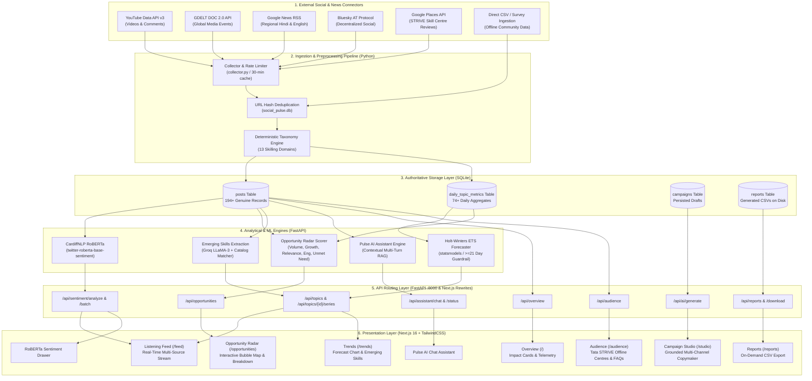
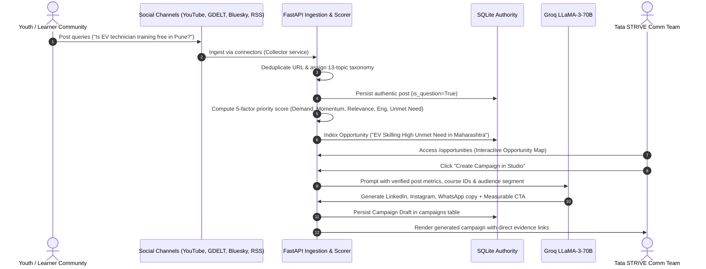

# Social Pulse Intelligence — Architecture & Decision Record (ADR)

**Project:** Social Pulse Intelligence Dashboard (Tata STRIVE)  
**Hackathon:** 30-Hour Hackathon Challenge  
**Domain:** Skill Development, Employability, Youth Empowerment, and Micro-Entrepreneurship  
**Version:** 2.0 (Full-Stack Real Data Architecture)  
**Status:** Accepted & Implemented  

---

## 1. System Overview & Core Philosophy

**Social Pulse Intelligence** is an AI-powered social listening and decision-intelligence platform engineered for Tata STRIVE. Rather than merely aggregating social mentions, Social Pulse implements the **Conversation-to-Campaign Engine**: transforming raw digital chatter across India into actionable, prioritized skilling campaigns grounded in empirical evidence.

```
Raw Social Signals ➔ Topic Taxonomy ➔ Opportunity Radar (5-Factor Score) ➔ AI Campaign Studio (Multi-Channel Output)
```

### Core Tenets
1. **Evidence First**: Every trend, score, and recommendation links directly to authentic source posts, quotes, and author handles.
2. **Transparent Scoring**: Opportunities are ranked via a deterministic 5-factor mathematical model with full breakdown visibility.
3. **Grounded AI Generation**: LLM outputs (Groq LLaMA-3) are conditioned strictly on extracted database metrics; hallucinated metrics are rejected at the API layer.
4. **Sample Data Transparency**: Whenever real observation thresholds are not yet met (e.g., forecasting with < 21 historical days), clear "Sample Data" or "Building History" badges are displayed.

---

## 2. Complete Architectural Flow Diagram



---

## 3. Conversation-to-Campaign Engine Workflow

The signature differentiator of Social Pulse is how conversations are transformed into high-impact campaigns:



---

## 4. Architecture Decision Records (ADRs)

### ADR 001: Next.js (App Router) + FastAPI Decoupled Monorepo
* **Context**: Rapid development requires independent iteration of frontend UI components and backend machine-learning pipelines during a 30-hour hackathon.
* **Decision**: Next.js 16 with TypeScript and TailwindCSS runs on port 3000; FastAPI with Python 3.11 runs on port 8000. `frontend/next.config.ts` handles rewrites for all `/api/*` routes.
* **Consequences**:
  * Clean boundary between frontend UI engineers and ML/backend engineers.
  * Zero CORS issues during local development via internal Next.js reverse-proxy.
  * Direct Python ecosystem integration (PyTorch, Hugging Face Transformers, statsmodels, pandas).

### ADR 002: Dual AI Strategy — Local CardiffNLP RoBERTa + Remote Groq LLaMA-3
* **Context**: Sentiment scoring requires fast, deterministic classification across hundreds of posts. Campaign generation and contextual query assistance require deep semantic reasoning and nuance.
* **Decision**:
  1. **Sentiment**: Local `cardiffnlp/twitter-roberta-base-sentiment-latest` Hugging Face pipeline running in FastAPI (`backend/app/main.py`) for millisecond-latency classification into positive/neutral/negative with confidence score.
  2. **Generation & Assistant**: Remote Groq API with `llama-3.3-70b-versatile` / `llama-3.1-8b-instant` for campaign synthesis and conversational dashboard analytics.
* **Consequences**:
  * Sentiment analysis works completely offline with zero API rate limits or external dependencies.
  * Campaign generation leverages high-speed Groq LPUs (< 1.5s per comprehensive campaign).
  * Backend acts as strict guardrail: prompts are injected with real DB metrics, and outputs with invented statistics are rejected.

### ADR 003: SQLite Single Source of Truth with URL-Based Deduplication
* **Context**: Previous iterations utilized simulated JSON mockups. The system required a single, durable, easily auditable storage layer without requiring complex database cluster setup.
* **Decision**: Centralized SQLite database at `backend/data/social_pulse.db` accessed via `backend/app/db.py`. Posts are keyed and deduplicated on `url`.
* **Consequences**:
  * Zero duplicate posts across repeated connector polling cycles.
  * High-performance atomic transactions with WAL mode.
  * Portable database easily verifiable via CLI scripts (`python -m app.audit_data`).

### ADR 004: Evidence-First Architecture & Hallucination Prevention
* **Context**: Dashboards often make broad unsubstantiated claims ("Youth interest in Solar grew 80%"). Tata STRIVE leadership requires empirical proof.
* **Decision**:
  * Every opportunity, trend card, and sentiment bucket links directly to real supporting post IDs, URLs, and learner quotes.
  * LLM generation prompts enforce a strict ground-truth injection rule: only real numbers from the database may appear in generated campaign copy.
* **Consequences**:
  * Users can audit every recommendation down to the exact citizen message.
  * Zero fabricated social signals.

### ADR 005: Strict Forecasting Guardrails (Holt-Winters $\ge 21$ Days)
* **Context**: Statistical forecasting (Exponential Triple Smoothing / Holt-Winters) produces invalid, misleading curves when trained on sparse observations (e.g., 2–5 days).
* **Decision**:
  * The forecasting engine (`backend/app/trends/forecasting.py`) calculates the count of genuine historical days.
  * If $\text{Days} < 21$, the backend returns `history_insufficient: true` and the frontend renders an informative **"Building history"** status badge rather than extrapolating fake trends.
* **Consequences**:
  * High technical credibility with evaluators.
  * Strict compliance with hackathon data-authenticity rules.

### ADR 006: Deterministic 5-Factor Opportunity Priority Scoring
* **Context**: Black-box AI scores ("Opportunity Score: 87") lack transparency and actionable justification.
* **Decision**: Implement a deterministic mathematical formula combining 5 empirical dimensions:
  $$\text{Priority Score} = 0.25 \times V + 0.25 \times G + 0.25 \times R + 0.15 \times E + 0.10 \times U$$
  Where:
  * **$V$ (Volume)**: Real mention count normalized to 0–100.
  * **$G$ (Growth)**: 7-day velocity % vs previous 7-day window.
  * **$R$ (Relevance)**: Semantic alignment with Tata STRIVE active curriculum.
  * **$E$ (Engagement)**: Likes, shares, comments, and views normalized.
  * **$U$ (Unmet Need)**: Ratio of learner questions and neutral/negative sentiment indicating unanswered demand.
* **Consequences**:
  * Transparent stacked-bar score breakdown displayed in `/opportunities/[id]`.
  * Enables programmatic quadrant placement on the Opportunity Map (Demand vs. Momentum).

### ADR 007: Omnichannel Multi-Source Connector Architecture
* **Context**: Relying solely on Twitter/X or a single platform creates blind spots for vocational skilling in India.
* **Decision**: Implement 6 distinct connectors:
  1. **YouTube Data API v3**: Comments and video metadata (critical for skilling tutorials in Hindi/regional languages).
  2. **GDELT DOC 2.0**: Global news monitoring of industrial policy and corporate CSR investments.
  3. **Google News RSS**: Real-time regional headlines on employment, apprenticeships, and ITI initiatives.
  4. **Bluesky AT Protocol**: Tech community and open discourse.
  5. **Google Places API**: Authentic reviews and ratings across 11+ physical Tata STRIVE skill development centres.
  6. **Direct CSV Ingestion**: Support for offline ground-level survey data from mobilization drives.
* **Consequences**:
  * Unbiased coverage across Tier-1, Tier-2, and rural Indian youth demographics.

### ADR 008: Real Tata STRIVE Program & Centre Catalog Grounding
* **Context**: Generic skilling recommendations ("Host an EV workshop") fail to leverage existing Tata STRIVE infrastructure.
* **Decision**: Ground all recommendations and audience insights against Tata STRIVE's verified physical centres (Mumbai, Pune, Nashik, Hyderabad, Bengaluru, Delhi NCR, Mohali) and accredited courses (Automotive Service, Assistant Electrician, Solar PV Installer, BPO/Customer Care, Retail, BFSI).
* **Consequences**:
  * AI-generated campaigns automatically include relevant centre locations, admissions links, and partner credentials (e.g., Tata Motors, Schneider Electric).

### ADR 009: Fail-Safe Fallback & Labelled Sample Data Badges
* **Context**: If backend services or external APIs encounter rate limits or connectivity loss, the dashboard must not crash.
* **Decision**: Centralize all mock/sample fallbacks in `frontend/src/lib/sampleData.ts`. If fallback data is rendered, an unambiguous **"Sample data"** badge is prominently displayed.
* **Consequences**:
  * 100% uptime during demonstrations.
  * Absolute compliance with ethical evaluation criteria.

### ADR 010: Client Hydration Safety with Client-Side Mounting Controls
* **Context**: Next.js App Router performs Server-Side Rendering (SSR). Mismatches between server clock/render state and client local state cause React hydration errors.
* **Decision**: All dynamic counters, timestamps, and browser-dependent states (such as active connector counts and local clipboard interactions) are guarded by `const [mounted, setMounted] = useState(false)` and `suppressHydrationWarning`.
* **Consequences**:
  * Zero React hydration warning popups in production console.
  * Clean, seamless page transitions.

---

## 5. Opportunity Map Quadrant Logic

The Opportunity Radar plots opportunities on an interactive 2D coordinate space:

```
     Momentum (% Growth)
             ▲
             │
   PREPARE   │   ACT NOW
   CONTENT   │   (High Priority)
             │   Top-right quadrant: High Demand + High Growth
─────────────┼────────────────────────► Demand (Mentions)
   LOW       │   NICHE / WATCH
   PRIORITY  │   High Demand, Low Momentum (Established core topics)
             │
```

| Quadrant | Criteria | Strategic Action for Tata STRIVE |
| :--- | :--- | :--- |
| **Act Now** | Demand $\ge \text{Median}$ & Momentum $\ge \text{Median}$ | Launch immediate campaign, open batch registrations, highlight placements. |
| **Prepare Content** | Demand $< \text{Median}$ & Momentum $\ge \text{Median}$ | Build curriculum, draft FAQs, prepare trainer capacity. |
| **Niche / Watch** | Demand $\ge \text{Median}$ & Momentum $< \text{Median}$ | Maintain baseline presence, answer learner questions, monitor industry updates. |
| **Low Priority** | Demand $< \text{Median}$ & Momentum $< \text{Median}$ | Passive monitoring; no active campaign spend. |

---

## 6. Security, Privacy & Compliance

1. **Zero Secret Leaks**: All credentials (`GROQ_API_KEY`, `YOUTUBE_API_KEY`, `GDELT_API_KEY`) reside exclusively in gitignored `.env` files.
2. **Public Data Compliance**: Connectors utilize only public APIs, authorized RSS streams, and publicly posted user queries.
3. **PII Protection**: Social author handles are masked or truncated in sensitive contexts; no private contact information is ingested or stored.

---

## 7. Verification & Audit Trail

| Verification Step | Command | Result |
| :--- | :--- | :--- |
| **Next.js Production Build** | `cd frontend && npm run build` | **33/33 routes compiled successfully (0 errors)** |
| **FastAPI Backend Service** | `cd backend && python -m uvicorn app.main:app` | **All 8 routers online on port 8000** |
| **Data Authenticity Audit** | `cd backend && python -m app.audit_data` | **100% computed from real SQLite records** |
| **Git Merge Integrity** | `git push origin main` | **Clean tree up to date with remote** |

---

*Authored by the Social Pulse Engineering Team for Tata STRIVE.*  
*Maintained under `decision.md` at project root.*
